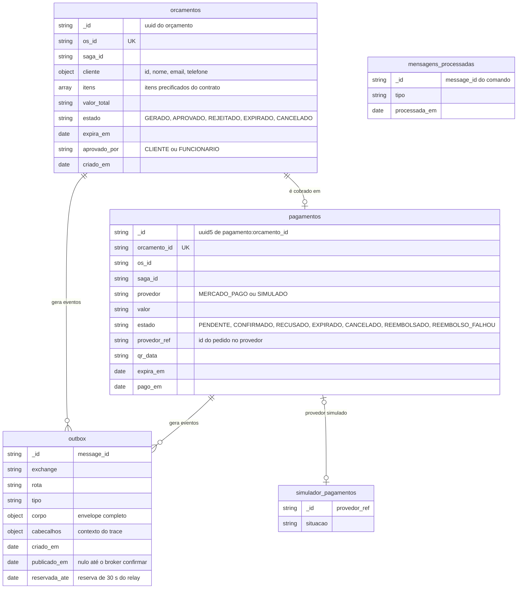
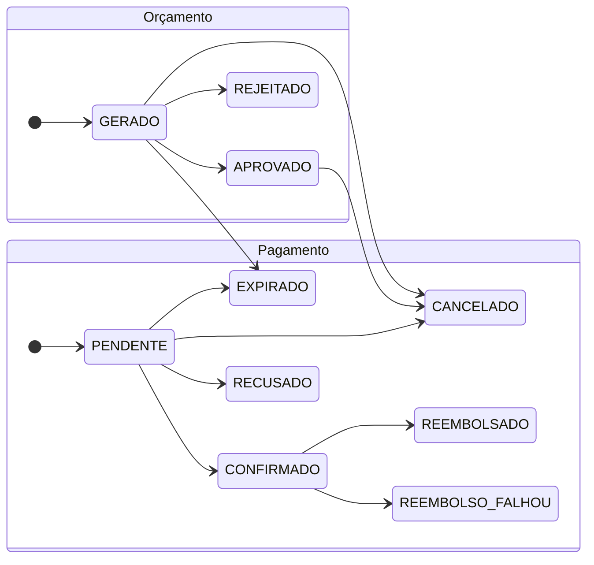

# Modelo de dados

Coleções do MongoDB do Billing (banco `billing`). Cada comando e cada decisão gravam estado, outbox e
inbox numa única transação, o que exige replica set (ADR-020 e ADR-021). Dinheiro fica como texto com
duas casas (`"150.00"`), como no contrato das mensagens; datas ficam em UTC.

## Diagrama

## Coleções

| Coleção | Papel |
|---|---|
| `orcamentos` | Um por OS. Nasce `GERADO` com validade de `ORCAMENTO_VALIDADE_MINUTOS`. |
| `pagamentos` | Um por orçamento aprovado e cobrado. O `_id` é derivado do orçamento, então repetir a cobrança reaproveita a chave de idempotência no provedor. |
| `outbox` | Eventos a publicar em `oficina.eventos`. O relay reivindica cada mensagem com `find_one_and_update` (`reservada_ate`), para que duas réplicas não publiquem a mesma. |
| `mensagens_processadas` | Inbox: o `_id` é o `message_id`; uma chave duplicada marca a mensagem como repetida e ela não tem efeito. |
| `simulador_pagamentos` | Situação das cobranças do provedor simulado. Só é usada com `PAGAMENTO_PROVEDOR=simulado`. |

## Índices

Criados na subida do serviço.

| Coleção | Índice | Motivo |
|---|---|---|
| `orcamentos` | `os_id` (único) | Um orçamento por OS; consulta pela rota e pelos comandos. |
| `orcamentos` | `estado` | Busca dos orçamentos vencidos na conciliação. |
| `pagamentos` | `orcamento_id` (único) | Um pagamento por orçamento. |
| `pagamentos` | `provedor_ref` | Webhook do Mercado Pago. |
| `pagamentos` | `estado` | Busca dos pagamentos pendentes na conciliação. |
| `outbox` | `(publicado_em, criado_em)` | Relay lê as pendentes em ordem de criação. |

## Estados

Toda mudança de estado grava com filtro pelo estado anterior; quem perde a corrida entre réplicas não
publica o evento.
